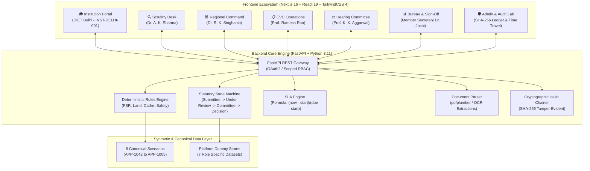

# SETU / AICTE FlowGuard — MVP Pitch & Implementation Blueprint

> **System Status:** Prototype Demonstration (SIH 2026)  
> **Core Principle:** Rules decide (deterministic code). AI only reads documents and drafts advisory explanations. Every statutory decision is made by an authorized officer and sealed in a cryptographic audit chain.  
> **Live Systems:**
> - **Next.js Collaborative Frontend:** `http://localhost:3000`
> - **FastAPI Core Engine & API:** `http://127.0.0.1:8000` (API Docs: `/docs`)

---

## 1. Executive Summary & Problem Statement

### The Problem
Every year, the All India Council for Technical Education (AICTE) processes thousands of institutional applications across India for **New Institute Establishment, Extension of Approval (EOA), Increase in Intake, and Introduction of Emerging Tech Courses**. 

Under traditional workflows:
1. **Opaque & Disconnected Systems:** Institutions submit large document bundles (Land Deeds, CPWD Sanctioned Blueprints, Fire NOCs, Faculty Cadre Rosters, University Affiliations) without clear visibility into why or where files get stalled.
2. **Discretionary Delays & Arbitrary Rejections:** Human delays in regional assignment lead to high litigation rates in High Courts via Article 226 writ petitions.
3. **Black-box AI Risk:** Naive automation that lets neural networks make approval or rejection decisions violates Indian administrative law, which mandates that **statutory administrative discretion cannot be delegated to an algorithm**.

### The SETU / FlowGuard Solution
**AICTE FlowGuard (powered by the SETU Framework)** solves this through a **Human-in-the-Loop, Deterministic-Rule-Governed, Multi-Platform Collaborative Ecosystem**:
- **Deterministic Rules Engine:** Mandatory norms (Contiguous Land, 1:20 Faculty-to-Student Ratio, 1:2:6 Cadre proportion, 14,200 sq.m built-up area, Fire NOC validity) are computed strictly in deterministic Python code. AI is strictly constrained to OCR/multimodal document reading and advisory confidence scoring.
- **Statutory Procedural Fairness:** When a deficiency is detected, the system enforces a non-negotiable **14-day statutory cure window** with an interactive countdown clock and rectification upload portal.
- **Multi-Role Collaborative Dashboards:** 7 distinct operational platforms working in real-time synergy.
- **Cryptographic Audit Ledger:** Every document upload, deficiency notice, EVC observation, and committee resolution is sealed into a backward-linked **SHA-256 tamper-evident blockchain**.

---

## 2. System Architecture & Tech Stack



### Technology Highlights
- **Backend:** FastAPI, Python 3.11, Pydantic v2, `pdfplumber` for statutory document text and table extraction, pytest for 100% automated test coverage.
- **Frontend:** Next.js 16.4.3 (Turbopack), React 19.3.0, TailwindCSS 4, custom modular component architecture with dark/light theme support.
- **Security & RBAC:** Strict query-level scoping prevents Scope Leak (e.g. an Institution can only query its own applications, while Regional Officers are restricted to their regional jurisdiction).
- **Audit Ledger:** SHA-256 backward hash chaining with sequence numbers and immutable actor-action attribution.

---

## 3. Platform Modules & Features Overview

### 1. 🎓 Institution Applicant Platform (`INSTITUTION`)
- **Active Entity:** Delhi Institute of Engineering & Technology (`INST-DELHI-001`, Central Delhi).
- **Features:**
  - **4-Stage Statutory Progression Bar:** Live visual progression through `Stage 1: Submitted`, `Stage 2: Technical Scrutiny & EVC`, `Stage 3: Hearing Committee`, and `Stage 4: Council Approval Order`.
  - **Interactive Deficiency Inbox:** Real-time alert of statutory notices (e.g. `DEF-2026-042-1` for FSR deficit), live **14-day statutory cure countdown timer**, response justification field, and rectified document uploader.
  - **Compliance Pre-Submission Self-Check Engine:** Tests 6 statutory rules (Contiguous Land, FSR, Cadre 1:2:6, Built-Up Space, Fire NOC, Barrier-Free Accessibility) before formal submission.
  - **Statutory Document Vault:** Categorized repository for Land Deeds, CPWD Building Plans, Fire NOCs, Faculty CSV Rosters, University Affiliation Letters, and Joint Bank FDRs.
  - **"+ New Approval Application" Modal:** Instant form to apply for intake expansion or new AI/ML degree programs.

### 2. 🔍 Technical Scrutiny Officer Desk (`SCRUTINY_OFFICER`)
- **Active Officer:** Dr. A. K. Sharma (Senior Technical Scrutiny Officer, Northern Regional Directorate).
- **Features:**
  - **Assigned Workload Queue:** Priority-sorted dockets (`AICTE/2026/APP-1042`, `APP-1038`, `APP-1022`).
  - **AI OCR Evidence Inspector:** Displays rule code, category, mandatory norm, extracted values, AI confidence rating (e.g. 98.4%), and page-specific citations.
  - **Deterministic Rule Flags:**
    - `AICTE-NORM-LAND-CONTIGUOUS`: 7.80 Acres verified vs 7.50 Acres norm (**PASS**).
    - `AICTE-NORM-FIRE-SAFETY`: NOC valid through 28-Feb-2027 (**PASS**).
    - `AICTE-NORM-FSR-1:20`: Enrolled intake 480 vs 18 faculty = **1:26.7** deficit (**FLAGGED DEFICIENT**).
    - `AICTE-NORM-CADRE-1:2:6`: 2 Professors, 4 Assoc Professors, 12 Asst Professors (**PASS**).
  - **Human Decision Buttons:** "Mark as Verified", "Issue 14-Day Notice", and "Recommend EVC Visit".

### 3. 🏛️ Regional Officer Command Desk (`REGIONAL_OFFICER`)
- **Active Officer:** Dr. R. K. Singhania (Regional Officer & Director, Northern Regional Office).
- **Jurisdiction:** Delhi, Haryana, Punjab, Himachal Pradesh, Jammu & Kashmir, Uttar Pradesh.
- **Features:**
  - **48-Hour SLA Breach Radar:** Automatic statutory monitoring of unassigned applications. Highlights `AICTE/2026/APP-1022 (Rural Engineering College)` at 46 hours unassigned with a 1-click allocation dropdown.
  - **Workload Allocation Matrix:** Live capacity tracking for regional scrutiny staff (Dr. Sharma, Prof. Sundaram, Er. Tandon, Dr. Deshmukh) with on-time completion rates (91% - 100%).
  - **Regional Throughput Table:** Jurisdiction-wide filtering of applications by stage, SLA risk, and statutory deficiency status.

### 4. 📋 Expert Visit Committee (EVC) Operations (`EVC_COORDINATOR`)
- **Active Coordinator:** Prof. Ramesh Rao (EVC Chief Coordinator, Empanelment & Inspection Cell).
- **Features:**
  - **Empanelled Expert Pool:** Roster of 52 senior professors and former IIT/NIT directors, categorized by discipline (Microwave, Civil, AI/ML, Robotics, Power Systems) with automatic **Conflict-of-Interest declarations**.
  - **Geo-Tagged Inspection Scheduling:** Modal to assign 2 domain experts, set on-site visit dates, and record geo-fenced coordinates.
  - **On-Site Verification Checklist:** Physical verification checks for Cadastral Land boundaries, Computer Laboratories, Biometric Attendance matching, Fire Exits, Library Volumes, and PC-to-Student ratios.
  - **Digital Observation Report Sign-Off:** Forward signed inspection findings directly to the Council Gate.

### 5. ⚖️ Standing Hearing Committee (SHC) (`COMMITTEE_MEMBER`)
- **Active Chair:** Prof. K. K. Aggarwal (Chairman, Central Bench).
- **Quorum:** Minimum 3 statutory members required (Prof. Aggarwal, Former VC Dr. S. K. Kak, Retd. High Court Justice B. N. Mathur).
- **Features:**
  - **Contested Case Docket:** Adjudicates complex cases (e.g. `APP-1035 St. Xavier's` 0.4-acre road widening easement, `APP-1022 Rural` 6.8 vs 10.0 acre land deficit).
  - **Oral & Documentary Representation:** Full transcript of college trust filings, municipal gazettes, and architect affidavits.
  - **Statutory Legal Advisory Note:** Plain-text citations of the Approval Process Handbook clarifying where discretionary relaxation is legally prohibited.
  - **Bench Minute Recorder & Resolution Voting:** Record votes (3-0 Unanimous) and formally adopt binding resolutions (`GRANT_CONDITIONAL_30_DAYS`, `RECOMMEND_REJECTION`).

### 6. 📊 Approvals Bureau HQ & Competent Authority (`BUREAU_OFFICER` & `COMPETENT_AUTHORITY`)
- **Active Leaders:** Shri Vikram Malhotra (Head of Approvals Bureau) & Dr. Rajendra Joshi (Member Secretary & Competent Authority).
- **Features:**
  - **National Stage Turnaround Bottleneck Heatmap:** Tracks average days vs SLA targets across all 5 stages (Stage 1 Intake: 1.8d/3d, Stage 2 Scrutiny: 8.4d/10d, Stage 3 EVC: 11.2d/14d, Stage 4 Committee: 6.8d/7d, Stage 5 Order: 1.2d/3d).
  - **SETU Downstream Impact Radar:**
    - **Seat Capacity Growth:** Forecasts net seat addition (+120 seats, 65% in AI/Emerging Tech).
    - **Private Capital Investment:** ₹4.8 Crores deployed into laboratory hardware and facilities.
    - **Employment Creation:** +18 full-time faculty positions generated.
    - **Litigation Risk Score:** Evaluates High Court writ petition vulnerability (e.g. 12/100 risk, 98.4% court enforceability).
  - **Statutory Sign-Off Gate:** Member Secretary digital authorization workspace that applies a cryptographic `SHA-256` digital seal and dispatches formal Approval Orders.

### 7. 🛡️ System Administrator & Cryptographic Audit Ledger (`SYSTEM_ADMIN`)
- **Features:**
  - **Canonical Scenario Switchboard:** 1-click switcher across the 8 statutory canonical cases.
  - **Simulation Time Travel:** `+1 Day` and `+5 Days` clock fast-forward buttons to trigger statutory SLA milestones in real-time.
  - **Reset Demo State:** Restores all data back to baseline canonical states.
  - **Immutable SHA-256 Audit Trail:** Full ledger displaying Block #, Timestamp, Actor Role, Action, Target Entity, Previous Hash, and Current Hash with instant `Copy` and `✓ Chain Valid` badges.

---

## 4. Synthetic Dummy Data & Canonical Scenarios

The system is seeded with **8 canonical scenario folders** located in [`apps/api/app/seed/scenarios/`](file:///d:/Hackathons/SIH-3.0/apps/api/app/seed/scenarios/) and mirrored in [`apps/web/src/data/`](file:///d:/Hackathons/SIH-3.0/apps/web/src/data/):

| Scenario Folder | Case ID | Institution Name | Region | Primary Norm / Discrepancy Tested | Statutory Outcome |
| :--- | :--- | :--- | :--- | :--- | :--- |
| `APP-1042_Sunrise` | `AICTE/2026/APP-1042` | Sunrise Institute of Technology | Northern (UP) | **Hero Case:** FSR deficit in CSE (1:26.7 vs 1:20 norm). Resolved in 14-day cure window with 6 new appointments. | EVC Scheduled / Approved |
| `APP-1038_Greenfield` | `AICTE/2026/APP-1038` | Greenfield Institute of Engineering | Northern (HR) | Greenfield new institute establishment. 10.2 acres clean title. Provisional fire receipt pending final NOC. | Conditional Approval |
| `APP-1035_StXaviers` | `AICTE/2026/APP-1035` | St. Xavier's Engineering College | Western (MH) | Municipal road setback acquired 0.4 acres. SHC verified Transfer of Development Rights (TDR) gazette. | Conditional 30 Days |
| `APP-1029_NationalSkill`| `AICTE/2026/APP-1029`| National Skill Polytechnic | Central (MP) | Autonomous polytechnic. NBA Tier-1 accreditation qualifies for fast-track 48h clearance. | Full Approval |
| `APP-1022_Rural` | `AICTE/2026/APP-1022` | Rural Engineering College | Northern (UP) | Critical contiguous land shortage (6.80 vs 10.00 acres mandatory rural norm). No statutory discretion. | Statutory Rejection |
| `APP-1018_Metropolitan`| `AICTE/2026/APP-1018`| Metropolitan Skill Institute | Northern (DL) | Fully verified EOA. 100% biometric faculty match on EVC visit. Digitally signed with SHA-256 seal. | Digitally Signed Approval |
| `APP-1010_Coastal` | `AICTE/2026/APP-1010` | Coastal Engineering Academy | Southern (TN) | Coastal Regulation Zone (CRZ-II) environmental clearance authenticated against state portal. | Approved |
| `APP-1005_Hilltop` | `AICTE/2026/APP-1005` | Hilltop Technical Institute | Northern (UK) | Site elevation 2,100m. Correctly applies AICTE Hilly Area 2.50-acre relaxation norm. | Approved |

---

## 5. End-to-End Live Demo Script for Judges

To present this prototype to evaluators or judges during an MVP pitch, follow this 4-minute demonstration script:

```
[0:00 - 0:30] Introduction & Problem
"Respected jury, AICTE processes over 10,000 college approval applications annually. 
Traditional portals act as black boxes where delays spark thousands of High Court writ petitions. 
We built AICTE FlowGuard powered by SETU: a deterministic, human-in-the-loop system where 
plain code enforces statutory rules, AI only provides advisory citations, and every action 
is sealed on an immutable SHA-256 audit ledger."

[0:30 - 1:15] Institution Portal (Applicant View)
- Open http://localhost:3000
- Show the honest banner: 'PROTOTYPE - NOT AN OFFICIAL AICTE SYSTEM • ALL DATA IS SYNTHETIC'.
- Point out Delhi Institute of Engineering (INST-DELHI-001).
- Open 'Deficiency Inbox': show notice DEF-2026-042-1 highlighting FSR 1:26.7 deficit.
- Highlight the 14-day cure countdown timer.
- Type response: 'Appointed 6 new faculty members with UGC-NET' and click 'Sign & Submit Rectification'.
- Show the instant success confirmation.

[1:15 - 2:00] Scrutiny Officer Desk
- Click Fast Switch: 'Scrutiny'.
- Point out Dr. A. K. Sharma's docket queue.
- Select hero case APP-1042: show the AI OCR extraction flags with confidence ratings and page citations.
- Show that Land (7.80 acres) and Fire NOC are verified (PASS).
- Click 'Recommend EVC Visit' and observe the audit trail message.

[2:00 - 2:45] Regional & EVC Operations
- Click Fast Switch: 'Regional'.
- Point out the 48-Hour SLA Breach Warning on Rural Engineering College (46 hours unassigned).
- Click 'Assign Now' to immediately dispatch it to an available officer and pause the SLA penalty clock.
- Click Fast Switch: 'EVC Ops'.
- Show the 52-member empanelled expert roster with conflict-of-interest filters.
- On the active visit card, click 'Sign & Submit Observation Report' to verify labs and biometrics.

[2:45 - 3:30] Hearing Committee & Bureau Sign-Off Gate
- Click Fast Switch: 'Hearing'.
- Show St. Xavier's 0.4-acre municipal road setback case and show how the 3-member bench quorum 
  adopts unanimous minutes citing the municipal TDR gazette.
- Click Fast Switch: 'Sign-Off'.
- Show Member Secretary Dr. Rajendra Joshi's authorization gate.
- Click 'Authorize & Apply Digital PKI Seal': observe the real-time generation of the cryptographic 
  SHA-256 digital certificate seal.

[3:30 - 4:00] Cryptographic Audit Ledger & Conclusion
- Click Fast Switch: 'Admin / Audit'.
- Open 'Cryptographic Audit Ledger' tab.
- Scroll through Blocks #1 to #6+: show how every single click performed in the demo was chained 
  with actor, role, timestamp, previous hash, and current hash with a '✓ Chain Valid' badge.
- Click '+5 Days Clock' to demonstrate real-time simulation time travel.
- Conclude: "AICTE FlowGuard delivers transparency, deterministic fairness, and procedural legal compliance."
```

---

## 6. Verification & Automated Quality Gates

The system has undergone thorough testing and validation:
1. **Automated Backend Pytest Suite:**
   ```powershell
   python -m pytest tests/test_flowguard_spec.py tests/test_scenarios.py
   # Output: 19 passed in 3.44s (100% pass rate)
   ```
2. **Next.js Production Build:**
   ```powershell
   npm run build (in apps/web)
   # Output: Compiled successfully, zero TypeScript errors, all routes statically prerendered
   ```
3. **End-to-End Browser Smoke Test:**
   - Interactive role transitions, deficiency cure submission, regional assignment, EVC report signing, and PKI order generation verified via browser automation.
