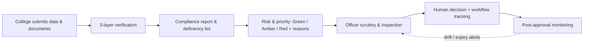

# AICTE Compliance & Approval Support System (ACAS)

> **Smart India Hackathon 2026** · AICTE · Software
> *An AI-assisted verification, prioritisation and monitoring layer for AICTE approvals. Name is a placeholder.*

**Rules identify compliance gaps. AI extracts and analyses information. Risk scoring prioritises scrutiny. Human officers retain the final authority.**

ACAS does **not** approve or reject institutions. It helps officers verify faster and more consistently, see *why* an application needs attention, track deadlines, and keep watching compliance after approval.

> ⚠️ **Status:** pre-prototype. Sections marked *(planned)* describe the intended build. All ratios, thresholds, weights and SLA values in this repo are **illustrative demo settings**, not official AICTE rules. Load real values from the AICTE Approval Process Handbook and record the clause reference.

Docs: [`prd.md`](./prd.md) (requirements) · [`pwd.md`](./pwd.md) (plan & tasks)

---

## What it does



### Three verification layers
| Layer | What it checks | Example |
|---|---|---|
| **1. Rule engine** | Numeric/date rules from configurable rulebook | Faculty 25 vs required 30 → shortfall 5 *(demo ratio)* |
| **2. Document AI** | Extract fields from uploaded documents, compare with declared | Fire NOC expiry: declared Dec, document says Nov → mismatch |
| **3. Cross-record validation** | Consistency across records | Same PAN in two colleges with overlapping dates |

### Main features
- **Configurable rule engine**: thresholds are data with versions and source clauses
- **Document AI** with confidence and side-by-side evidence view
- **Ghost-faculty signals**: duplicate identifiers, unusual employment patterns *(signals, not proof)*
- **Faculty drift monitor**: month-by-month compliance timeline after approval
- **Explainable risk score**: Green / Amber / Red with top reasons
- **Workflow state machine** with role-gated transitions, SLA timers, alerts, escalations
- **Audit trail** of every action; optional hash-chain verification
- **Safeguards**: advisory labels, decision gate for competent authority only

---

## Principles
1. Humans decide; the system advises.
2. Every flag shows evidence and reasoning.
3. A flag means *investigate*, never *guilty*.
4. AI reads documents; it does not certify authenticity.
5. Low-confidence AI results go to a person.
6. Rules are configuration, not code.
7. The backend calculates and controls transitions; the browser only displays.
8. Prototype uses synthetic data only.

---

## Architecture *(planned)*

```
Next.js  ── College portal · Officer dashboard · Reports · Alerts
   │ REST
FastAPI  ── Auth · API · Workflow · Rule evaluation · Risk · Monitoring
   │                │
PostgreSQL     Redis + workers  ── SLA monitor · Document AI jobs · Monitoring job
   │
Object storage (documents)
Verification services: rule engine · OCR/Document AI · duplicate detector · drift monitor · risk scorer
```

| Layer | Tech |
|---|---|
| Frontend | Next.js, TypeScript, Tailwind |
| Backend | FastAPI, Pydantic, SQLAlchemy, Alembic |
| Database | PostgreSQL |
| Jobs | Redis + Celery/RQ/Arq |
| OCR / AI | Tesseract or PaddleOCR; optional LLM with strict JSON schema validation |
| Infra | Docker Compose |
| Tests | pytest, Playwright (optional) |

---

## Workflow states

```
DRAFT → SUBMITTED → AUTO_VERIFICATION → SCRUTINY ⇄ RETURNED_FOR_CORRECTION
SCRUTINY → EVC_PENDING → EVC_COMPLETED → COMMITTEE → DECISION_PENDING
DECISION_PENDING → LOA_ISSUED | LOD_ISSUED | LOR_ISSUED → MONITORING
```
Illegal transitions are rejected (HTTP 409) and logged. Only the **Competent Authority** role can record a decision.

---

## Quick start *(planned layout — adjust once code exists)*

```bash
git clone <repo-url> acas && cd acas
cp .env.example .env             # DB, Redis, storage, JWT secret, OCR/LLM keys (if used)
docker compose up --build        # web + api + db + redis + worker
docker compose exec api python -m app.seed   # load synthetic colleges & scenarios
```
- Web: http://localhost:3000
- API docs: http://localhost:8000/docs

### Environment variables *(example)*
| Variable | Purpose |
|---|---|
| `DATABASE_URL` | PostgreSQL connection |
| `REDIS_URL` | Job queue |
| `JWT_SECRET` | Auth |
| `STORAGE_PATH` / `S3_*` | Document storage |
| `OCR_ENGINE` | `tesseract` / `paddle` |
| `LLM_API_KEY` | Optional, for Document AI extraction |
| `ID_HASH_KEY` | HMAC key for faculty identifier hashing |
| `SIM_MODE` | Enables simulated time for demos (never in production) |

---

## Project structure *(proposed)*

```
acas/
├─ apps/
│  ├─ web/                  # Next.js UI
│  └─ api/
│     ├─ app/
│     │  ├─ routers/        # REST endpoints
│     │  ├─ rules/          # rule engine (pure functions)
│     │  ├─ documents/      # OCR + extraction + comparison
│     │  ├─ crossrecord/    # duplicate detection, employment patterns
│     │  ├─ monitoring/     # faculty drift snapshots + alerts
│     │  ├─ risk/           # scoring + explanations
│     │  ├─ workflow/       # state machine, tasks, SLA, escalation
│     │  ├─ audit/          # audit log (+ hash chain)
│     │  └─ seed/           # synthetic data & scenarios
│     └─ tests/
├─ docs/                    # rulebook, API contract, diagrams
├─ docker-compose.yml
├─ prd.md · pwd.md · readme.md
```

---

## API overview *(v1)*

| Endpoint | Purpose |
|---|---|
| `POST /applications` | Create application |
| `POST /applications/{id}/documents` | Upload documents |
| `POST /applications/{id}/validate` | Run compliance checks |
| `GET /applications/{id}/report` | Consolidated compliance report |
| `GET /applications/{id}/risk` | Risk flags and score |
| `GET /colleges/{id}/faculty-trend` | Monitoring history |
| `POST /applications/{id}/transition` | Request permitted workflow transition |
| `POST /applications/{id}/decision` | Record decision (Competent Authority only) |
| `GET /dashboard/summary` | Dashboard statistics |

Full list in `prd.md` §9.

---

## Configuration examples

**Rule (illustrative):**
```json
{
  "rule_id": "FSR-001",
  "type": "ratio_min",
  "params": { "students_per_faculty": 20 },
  "severity": "HIGH",
  "source_clause": "<<fill from APH>>",
  "version": 1
}
```
Worked example: 600 students ÷ 20 = 30 required; 25 recorded → shortfall 5 (**demo rule**).

**Risk scoring (illustrative):** weighted sum of flags × severity × confidence, capped at 100. Green < 30, Amber 30–59, Red ≥ 60. Weights are configurable and need validation before any real use.

---

## Demo scenarios (synthetic)

| ID | Scenario | Expected |
|---|---|---|
| S1 | Clean college | All PASS · Green |
| S2 | Faculty shortfall (ABC: 600 students, 25 faculty) | FSR-001 FAIL, shortfall 5 |
| S3 | Fire NOC date mismatch | MISMATCH → needs review |
| S4 | Duplicate PAN with overlapping dates | DUPLICATE_OVERLAP flag |
| S5 | Faculty drift after approval | BELOW_REQUIREMENT + SHORT_TENURE_CLUSTER |
| S6 | ABC combined (S2+S3+S4) | Red, top reasons listed |
| S7 | Blurry NOC | UNREADABLE → human review |
| S8 | Overdue scrutiny | Warning → overdue → escalation |

Each scenario is covered by an automated test.

---

## Testing
```bash
docker compose exec api pytest            # unit + scenario tests
docker compose exec api pytest -k rules   # rule engine tests
```
Targets: rule & scoring modules ≥ 95% coverage; scenarios S1–S8 pass; unreadable/low-confidence documents never auto-pass.

---

## Safety, privacy and limits
- **Advisory only.** No automatic approval/rejection. Decision gate by role.
- **Not a forgery detector.** Document AI reads and compares; it does not authenticate documents.
- **Signals, not accusations.** Duplicate IDs, short tenure and drift require human investigation.
- **Illustrative values.** Demo ratios, weights and SLA timers are not official AICTE rules.
- **Workflow timers** are internal management aids; they don't replace statutory timelines.
- **Data.** Synthetic only. Identifiers are hashed (HMAC) and masked in the UI. Review DPDP Act 2023 obligations before using real data.

---

## Roadmap
- [ ] Phase 00: rulebook, ABC scenario, API contract
- [ ] Phase 01: app skeleton
- [ ] Phase 02: database & synthetic data
- [ ] Phase 03: rule engine
- [ ] Phase 04: document & cross-record verification
- [ ] Phase 05: risk scoring & workflow
- [ ] Phase 06: continuous faculty monitoring
- [ ] Phase 07: scorecard, PDF, QR demo cert, audit chain, heatmap
- [ ] Phase 08: testing, polish, demo

---

## Team
| Name | Track |
|---|---|
| _TBD_ | Rules & data |
| _TBD_ | Backend & workflow |
| _TBD_ | AI & verification |
| _TBD_ | Frontend |
| _TBD_ | Pitch & research |

## License
_To be decided (e.g., MIT)._

## Acknowledgements
Problem statements: AICTE via Smart India Hackathon 2026 — https://www.sih.gov.in/sih2026PS
Reference: AICTE Approval Process Handbook 2024-25 to 2026-27 — https://aicte.gov.in
